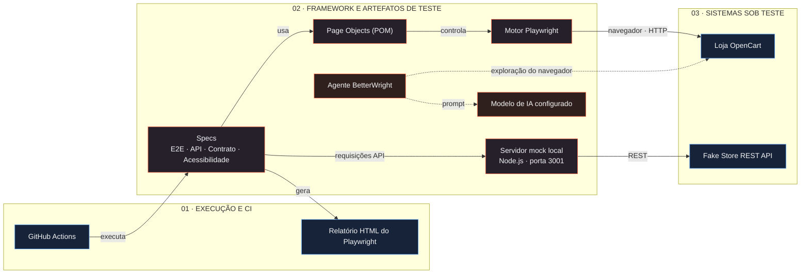

# LunaFlow

[](https://github.com/DavidsonLuna/QA-Harness-Pilot/actions/workflows/playwright.yml)

**LunaFlow** é um projeto de engenharia de qualidade com Playwright e TypeScript para testar uma loja OpenCart pública e a API de autenticação Fake Store. Reúne testes de ponta a ponta no navegador, API, contrato e acessibilidade, além de Page Objects reutilizáveis, um mock local de API e exploração opcional do navegador com BetterWright.

> O LunaFlow é uma suíte de testes para os sistemas de demonstração abaixo, não uma aplicação de e-commerce.

## Arquitetura

[**Abrir o diagrama interativo**](https://davidsonluna.github.io/QA-Harness-Pilot/architecture-diagram.html)

A prévia a seguir representa as camadas de execução, framework de testes e sistemas sob teste. O GitHub exibe esta versão estática; acesse o diagrama interativo para inspecionar componentes, filtrar camadas e simular uma execução.



## Cobertura

| Suíte | Local | Cobertura |
| --- | --- | --- |
| Ponta a ponta | `tests/e2e/` | Página inicial e login do OpenCart, recuperação de senha e tentativas de login inválidas. |
| API | `tests/api/` | Autenticação Fake Store com credenciais válidas, inválidas, ausentes ou malformadas, além de submissões repetidas. |
| Contrato | `tests/contract/` | Status HTTP, tipo de conteúdo JSON, campo do token e formato semelhante a JWT. |
| Acessibilidade | `tests/accessibility/` | Visibilidade dos campos de login e do controle de envio. |

Os testes de interface acessam a demonstração pública do OpenCart. Por padrão, os testes de API e contrato usam a Fake Store; é possível direcioná-los ao mock local para execuções repetíveis.

## Requisitos

- Node.js LTS e npm.
- Google Chrome no macOS. A configuração do Playwright usa o Chrome instalado no macOS e no CI; em outras plataformas locais, utiliza o Chromium fornecido pelo Playwright.

## Instalação

```bash
npm ci
```

No Linux local, instale o navegador Chromium se ele ainda não estiver disponível:

```bash
npx playwright install chromium
```

## Executar os testes

Para executar todas as suítes:

```bash
npm test
```

Para executar uma suíte específica:

```bash
npm run test:e2e
npm run test:api
npm run test:contract
npm run test:accessibility
```

Para abrir o navegador durante os testes:

```bash
npm run test:headed
```

Após uma execução, abra o relatório HTML do Playwright:

```bash
npm run test:report
```

## Mock local da API

O mock local, feito em Node.js, usa a porta `3001`. Inicie-o em um terminal:

```bash
npm run test:mock-server
```

Em outro terminal, execute as suítes de API e contrato contra o mock:

```bash
USE_LOCAL_MOCK=true FAKESTORE_BASE_URL=http://127.0.0.1:3001 npm test
```

Essa configuração só redireciona as requisições de API e contrato. Os testes de ponta a ponta e acessibilidade continuam acessando a demonstração pública do OpenCart.

## Exploração com BetterWright

Os scripts BetterWright oferecem exploração opcional do navegador assistida por IA, separada das suítes Playwright padrão:

```bash
npm run betterwright:login
npm run betterwright:agent
npm run betterwright:testmodel
```

## Integração contínua e publicação

A workflow **Playwright Tests** do GitHub Actions é executada em pull requests, atualizações da branch `main` e execuções manuais. As suítes de API e contrato rodam junto com os testes de ponta a ponta e acessibilidade no Ubuntu 24.04. Os relatórios do Playwright são publicados como artefatos, inclusive quando uma suíte falha.

Quando todos os testes passam na `main`, a workflow publica o diagrama interativo no [GitHub Pages](https://davidsonluna.github.io/QA-Harness-Pilot/architecture-diagram.html).

## Estrutura do projeto

```text
ai/betterwright/       Exploração opcional do navegador com IA
pages/                 Page Objects do Playwright
tests/
  accessibility/       Testes de acessibilidade
  api/                 Testes de comportamento da API
  contract/            Testes de contrato da API
  e2e/                 Testes de ponta a ponta no navegador
  fixtures/            Dados e configuração reutilizáveis
  mocks/               Mock local da Fake Store API
architecture-diagram.html
                       Diagrama interativo da arquitetura
```

## Licença

[MIT](LICENSE)
