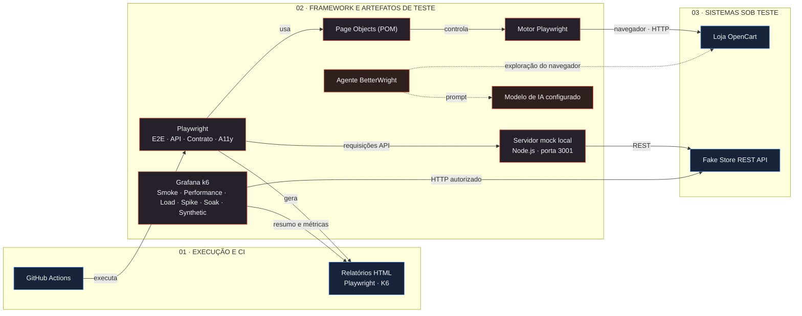

# LunaFlow

[](https://github.com/DavidsonLuna/QA-Harness-Pilot/actions/workflows/playwright.yml)

**LunaFlow** é um harness de engenharia de qualidade para uma loja OpenCart pública e a API de autenticação Fake Store. Reúne testes de ponta a ponta, API, contrato, acessibilidade e performance, com Playwright/TypeScript e Grafana k6, além de mock local, relatórios HTML executivos e exploração opcional com BetterWright.

> O LunaFlow é uma suíte de testes para os sistemas de demonstração abaixo, não uma aplicação de e-commerce.

## Arquitetura

[**Abrir o diagrama interativo**](https://davidsonluna.github.io/QA-Harness-Pilot/architecture-diagram.html)

A prévia a seguir representa as camadas de execução, framework de testes e sistemas sob teste. O GitHub exibe esta versão estática; acesse o diagrama interativo para inspecionar componentes, filtrar camadas e simular uma execução.



## Cobertura

| Suíte | Local | Cobertura |
| --- | --- | --- |
| Ponta a ponta | `tests/e2e/` | Página inicial, recuperação de senha e login inválido no OpenCart. |
| API | `tests/api/` | Login válido/inválido, payloads ausentes, nulos e malformados, campos inválidos e submissões concorrentes. |
| Contrato | `tests/contract/` | Status, Content-Type, token semelhante a JWT e resposta de credenciais inválidas. |
| Acessibilidade | `tests/accessibility/` | Rótulos e controles da tela de login. |
| Performance | `tests/performance/` | K6: smoke, performance, carga, pico, resistência e monitoramento sintético da API. |

Os testes de interface acessam a demonstração pública do OpenCart. API e contrato podem usar a Fake Store ou o mock local. Os testes de payload malformado são executados contra o mock para manter a cobertura determinística. O K6 não aponta para nenhum serviço por padrão: requer URL, credenciais e confirmação explícita de autorização.

## Requisitos

- Node.js LTS e npm.
- Grafana k6 (CLI) para as suítes de performance; consulte [instalação oficial](https://grafana.com/docs/k6/latest/set-up/install-k6/).
- Google Chrome no macOS. A configuração do Playwright usa o Chrome instalado no macOS e no CI; em outras plataformas locais, utiliza o Chromium fornecido pelo Playwright.

## Instalação

```bash
npm ci
```

No Linux local, instale o navegador Chromium se ele ainda não estiver disponível:

```bash
npx playwright install chromium
```

## Executar os testes

Para executar todas as suítes:

```bash
npm test
```

Para executar uma suíte específica:

```bash
npm run test:e2e
npm run test:api
npm run test:contract
npm run test:accessibility
```

### Performance e monitoramento sintético com K6

Configure o endereço e a conta de teste de um ambiente sob sua responsabilidade. O exemplo abaixo usa o mock local:

```bash
# Terminal 1
npm run test:mock-server

# Terminal 2
export K6_BASE_URL=http://127.0.0.1:3001
export K6_USERNAME=mor_2314
export K6_PASSWORD='83r5^_'
export K6_CONFIRM_AUTHORIZED_TARGET=true

npm run test:k6:smoke
```

Perfis disponíveis:

| Comando | Intenção | Carga inicial |
| --- | --- | --- |
| `npm run test:k6:smoke` | Verificação rápida de disponibilidade, contrato feliz e rejeição de credencial inválida. | 1 VU, 1 iteração. |
| `npm run test:k6:performance` | Medir latência e taxa de falha sob carga constante pequena. | 2 VUs por 1 minuto. |
| `npm run test:k6:load` | Observar o comportamento com aumento gradual e sustentado de usuários virtuais. | Até 10 VUs por cerca de 3 minutos. |
| `npm run test:k6:spike` | Observar a recuperação após um aumento abrupto de tráfego. | Pico de 20 VUs, execução curta. |
| `npm run test:k6:soak` | Procurar degradação ao longo de uma execução prolongada. | 5 VUs por 10 minutos. |
| `npm run test:k6:synthetic` | Executar verificações periódicas de jornada de API. | 1 requisição a cada 30 segundos, por 1 minuto. |

Todos os perfis exigem `K6_CONFIRM_AUTHORIZED_TARGET=true`. Carga, pico e resistência também exigem `K6_ALLOW_HIGH_LOAD=true`; confirme janela, capacidade, limites e plano de interrupção com o responsável pelo serviço antes de habilitar a carga:

```bash
export K6_ALLOW_HIGH_LOAD=true
npm run test:k6:load
```

Os perfis de execução e os limites iniciais podem ser ajustados com `K6_VUS`, `K6_DURATION`, `K6_P95_THRESHOLD_MS`, `K6_FAILURE_RATE_THRESHOLD`, `K6_API_PATH` e `K6_TIMEOUT`. Os limites são pontos de partida, não SLOs universais. Os testes de carga medem o endpoint de login; adapte o payload e os checks em `tests/performance/api.js` ao contrato do serviço sob teste.

Cada execução gera `performance-reports/<perfil>.html`, um relatório autocontido com indicadores, gráficos alternáveis de latência/checks e leitura executiva. Para monitoramento contínuo, agende o perfil `synthetic` em um scheduler/Grafana Cloud Synthetic Monitoring, proteja credenciais em secrets e configure alertas e retenção fora do repositório. O script não cria agendamento nem envia tráfego automaticamente.

#### Como interpretar os resultados

- **Latência p95**: compare com o SLO acordado e com uma baseline do mesmo ambiente.
- **Taxa de falha HTTP e checks**: diferencie falha técnica, rejeição esperada do smoke e falha do contrato.
- **Carga**: avalie throughput, latência e erros juntos; não aprove capacidade com base em um único número.
- **Spike/soak**: observe recuperação após o pico e tendências de latência/erros, memória e recursos do serviço em dashboards próprios.
- Compare execuções no mesmo ambiente e anote versão, região, configuração e janela. O relatório do harness resume uma execução; não substitui observabilidade nem análise de tendência.

Para abrir o navegador durante os testes:

```bash
npm run test:headed
```

Após uma execução, abra o relatório HTML do Playwright:

```bash
npm run test:report
```

## Mock local da API

O mock local, feito em Node.js, usa a porta `3001`. Inicie-o em um terminal:

```bash
npm run test:mock-server
```

Em outro terminal, execute as suítes de API e contrato contra o mock:

```bash
USE_LOCAL_MOCK=true FAKESTORE_BASE_URL=http://127.0.0.1:3001 npm test
```

Essa configuração só redireciona as requisições de API e contrato. Os testes de ponta a ponta e acessibilidade continuam acessando a demonstração pública do OpenCart.

## Exploração com BetterWright

Os scripts BetterWright oferecem exploração opcional do navegador assistida por IA, separada das suítes Playwright padrão:

```bash
npm run betterwright:login
npm run betterwright:agent
npm run betterwright:testmodel
```

## Integração contínua e publicação

A workflow **Playwright Tests** do GitHub Actions é executada em pull requests, atualizações da branch `main` e execuções manuais. As suítes de API e contrato rodam junto com os testes de ponta a ponta e acessibilidade no Ubuntu 24.04. Os relatórios do Playwright são publicados como artefatos, inclusive quando uma suíte falha.

Os perfis K6 são intencionalmente executados de forma manual, fora do CI padrão, para impedir carga acidental em serviços compartilhados. Integre-os a pipelines de performance dedicados apenas com alvo autorizado, isolamento, limites de custo/carga e aprovação operacional.

Quando todos os testes passam na `main`, a workflow publica o diagrama interativo no [GitHub Pages](https://davidsonluna.github.io/QA-Harness-Pilot/architecture-diagram.html).

## Próximos tipos de teste recomendados

1. **Capacidade e breakpoint**: encontrar limites de throughput e o ponto de saturação com limites e rollback definidos.
2. **Resiliência e recuperação**: indisponibilidade/degradação controlada de dependências, failover e tempo para recuperação.
3. **Rate limiting e quotas**: validar limites por usuário/tenant, headers e recuperação após throttling.
4. **Integridade sob concorrência**: idempotência, duplicidade e consistência de dados em operações concorrentes.
5. **Observabilidade e SLOs**: correlacionar métricas, logs e traces com as jornadas e alertas sintéticos.
6. **Segurança e compatibilidade**: análise autorizada de controles OWASP, autorização entre tenants e compatibilidade de contratos/versionamento.

Priorize primeiro capacity/breakpoint e rate limiting em staging, depois resiliência e integridade concorrente. Defina hipóteses, escopo, limites de impacto, responsáveis e critérios de interrupção antes de testes que alterem falhas ou dependências.

## Estrutura do projeto

```text
ai/betterwright/       Exploração opcional do navegador com IA
pages/                 Page Objects do Playwright
tests/
  accessibility/       Testes de acessibilidade
  api/                 Testes de comportamento da API
  contract/            Testes de contrato da API
  e2e/                 Testes de ponta a ponta no navegador
  fixtures/            Dados e configuração reutilizáveis
  mocks/               Mock local da Fake Store API
  performance/         Perfis Grafana k6 e relatório executivo
performance-reports/  Relatórios K6 gerados (ignorados pelo Git)
.github/skills/        Skill QA Performance para agentes Copilot
architecture-diagram.html
                       Diagrama interativo da arquitetura
```

O fluxo e as instruções reutilizáveis para criar novos cenários de performance ficam em [`.github/skills/qa-performance/SKILL.md`](.github/skills/qa-performance/SKILL.md).

## Licença

[MIT](LICENSE)
