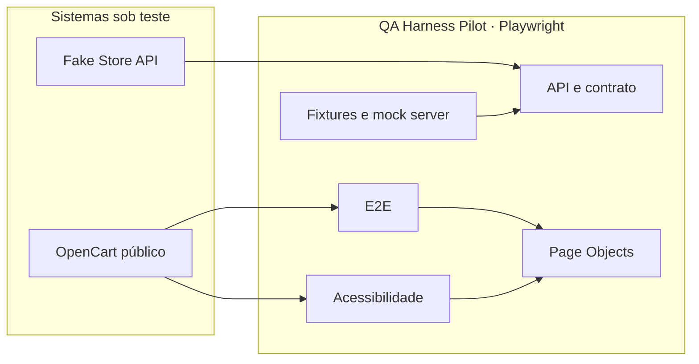

# QA Harness Pilot

[](https://github.com/DavidsonLuna/QA-Harness-Pilot/actions/workflows/playwright.yml)

Suíte Playwright para validar o OpenCart público e a Fake Store API. A cobertura é organizada em jornadas E2E, comportamento de API, contrato e acessibilidade.

## Arquitetura

[Abrir o diagrama interativo](https://davidsonluna.github.io/QA-Harness-Pilot/architecture-diagram.html)

Prévia da estrutura da suíte:



## Cobertura

| Suíte | Diretório | Foco |
| --- | --- | --- |
| E2E | `tests/e2e/` | Navegação na home, login, recuperação de senha e entradas inválidas. |
| API | `tests/api/` | Autenticação, entradas ausentes/malformadas, limites e submissões repetidas. |
| Contrato | `tests/contract/` | Status, headers e formato do payload de autenticação. |
| Acessibilidade | `tests/accessibility/` | Labels e controles nomeados no formulário de login. |

As massas de teste ficam em `tests/fixtures/` e os Page Objects em `pages/`.

## Pré-requisitos

- Node.js LTS
- Google Chrome instalado para execução local. No CI, o Playwright usa Chromium e WebKit gerenciados.

## Instalação

```bash
npm ci
npm run install-playwright
```

## Execução

```bash
npm test
npm run test:e2e
npm run test:api
npm run test:contract
npm run test:accessibility
```

Para executar com o navegador visível:

```bash
npm run test:headed
```

Após uma execução, abra o relatório HTML local com:

```bash
npm run test:report
```

## CI e publicação

A workflow `Playwright Tests` roda em pull requests e em atualizações da branch `main`, publicando os relatórios como artefatos mesmo quando um teste falha. Após os testes passarem na `main`, ela publica o diagrama interativo no GitHub Pages.

## Licença

MIT.
